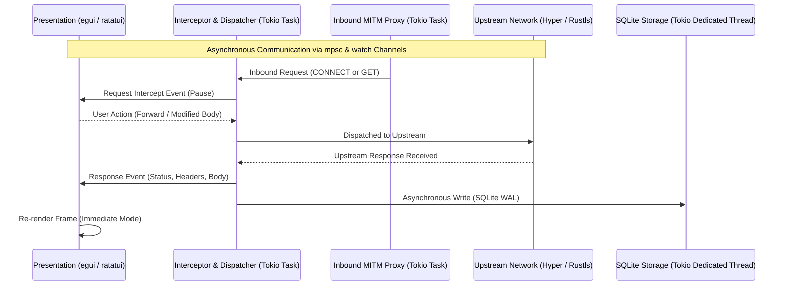

# Architecture Deep Dive

This document details the internal data flows, concurrency models, state machines, and subsystem interactions powering **Excalibur**.

---

## 1. Concurrency Model & Async Architecture

Excalibur is architected around the **Tokio** asynchronous runtime, decoupling network I/O, proxy listeners, and database persistence from the UI rendering loops.



### 1.1 Decoupling UI from Network I/O
* **UI Main Thread**: Runs the synchronous rendering loop (`eframe::run_native` for GUI at 60 FPS or `crossterm` event loop for TUI). The UI thread never blocks on network I/O, DNS resolution, or disk writes.
* **Tokio Async Worker Pool**: Handles all inbound proxy connections, upstream HTTP/2 multiplexing, TLS handshakes, and background security checks.
* **Thread-Safe Cross-Boundary Communication**: The UI communicates with background tasks via non-blocking channels:
  * `tokio::sync::mpsc`: For streaming new requests, audit findings, and log messages to the UI.
  * `tokio::sync::watch`: For broadcast configuration updates (e.g. interception toggled ON/OFF, upstream proxy changed).
  * `tokio::sync::oneshot`: For request-response coordination during manual pause-and-edit interception.

---

## 2. Traffic Interception State Machine

The traffic interception engine operates as an inline state machine capable of halting and mutating packets in both directions.

```
       [ Incoming HTTP Request ]
                   |
                   v
         +-------------------+
         | Filter Matching   |----( Does not match rule )----> [ Forward to Upstream ]
         +-------------------+
                   |
            ( Matches rule )
                   v
         +-------------------+
         | Breakpoint Active | <---> [ User In-Line Editor (GUI / TUI) ]
         +-------------------+
                   |
           ( User Action )
          /        |        \
         /         |         \
 [ Drop ]   [ Forward As-Is ]  [ Forward Modified ]
                           \         /
                            v       v
                     [ Upstream Request ]
```

### 2.1 State Transitions
1. **Received**: Request is ingested by the internal dispatcher or proxy server.
2. **Evaluated**: Matched against active regex rules (e.g. `URL contains /api/`, `Method == POST`, `Header X-Custom present`).
3. **Paused (Breakpoint)**: If matching rules are active and interception is enabled, the request is parked. A `oneshot::Sender` is held in memory while the request details are displayed in the UI editor.
4. **Mutated or Forwarded**:
   * If **Forwarded**, the original request continues to the upstream target.
   * If **Modified**, the user's edits (tampered headers, modified JSON body, swapped cookies) replace the original payload before sending.
   * If **Dropped**, a `403 Intercepted` or TCP reset is returned to the client.
5. **Response Evaluation**: The response from upstream undergoes the identical breakpoint cycle before returning to the browser canvas or downstream client.

---

## 3. Dynamic TLS MITM Certificate Pipeline

When intercepting HTTPS traffic as an inbound proxy, Excalibur dynamically impersonates target domains with on-the-fly generated X.509 certificates.

```
Downstream Client                 Excalibur MITM Proxy                 Upstream Target
       |                                   |                                  |
       |--- CONNECT target.com:443 ------->|                                  |
       |                                   |--- SNI: target.com ------------->|
       |                                   |<-- Upstream Cert Info -----------|
       |                                   |
       |                                   |-- 1. Check Cert Cache -----------+
       |                                   |   (Hit: Use Cached Leaf Cert)    |
       |                                   |   (Miss: Generate via Root CA) <-+
       |                                   |
       |<-- 200 Connection Established ----|
       |                                   |
       |<-- TLS Handshake (Forged Cert) ---|
       |--- Encrypted HTTP Request ------->|
       |                                   |--- Plaintext Request Parsed -----+
       |                                   |    (Interception & Storage)      |
       |                                   |--- Re-encrypted Request -------->|
```

### 3.1 Certificate Cache & Performance
* Forging RSA 2048-bit or ECDSA P-256 certificates on every request introduces significant CPU latency.
* Excalibur maintains an in-memory LRU certificate cache. Once a leaf certificate is signed for `target.com`, subsequent connections for that domain reuse the cached certificate and private key, reducing TLS negotiation latency to sub-millisecond speeds.

---

## 4. DOM Parsing & Hybrid Canvas Layout Pipeline

Excalibur converts raw HTML into interactive visual layouts without relying on external browser engines.

```
       [ Raw HTML Byte Stream ]
                   |
                   v
         +-------------------+
         |  HTML5 Tokenizer  | (html5ever)
         +-------------------+
                   |
                   v
         +-------------------+
         | Kuchiki DOM Tree  | (Hierarchical Node Structure)
         +-------------------+
          /        |        \
         /         |         \
        v          v          v
   [ DOM Tree   [ Resource  [ Hybrid Layout Engine ]
   Explorer ]   Extractor ]         |
                                    v
                          +-------------------+
                          | Visual Geometry   |
                          | (Boxes, Text Wrap)|
                          +-------------------+
                                    |
                            ( Target Output )
                            /               \
                           v                 v
                 [ egui Painter (GUI) ]   [ ratatui Buffer (TUI) ]
```

### 4.1 Hybrid View Synchronization
The layout pipeline generates a unified data model that feeds three synchronized views simultaneously:
1. **Visual Canvas**: Renders boxes, buttons, text nodes, and inputs. Clicking an element highlights the corresponding node in the DOM Tree Explorer.
2. **DOM Tree Explorer**: An interactive collapsible tree. Editing an attribute (e.g. changing `<input type="hidden">` to `type="text"`) immediately updates the visual canvas and underlying DOM model.
3. **Raw Syntax / Hex Viewer**: Directly displays the original byte stream with line numbers and security annotations.

---

## 5. Dual Scripting Engine Architecture

Excalibur embeds two distinct scripting environments tailored for separate phases of the security testing workflow.

```
                                  +-----------------------+
                                  |   Scripting Engine    |
                                  +-----------+-----------+
                                              |
                     +------------------------+------------------------+
                     |                                                 |
                     v                                                 v
        +-------------------------+                       +-------------------------+
        |     QuickJS Runtime     |                       |    Lua (mlua) Runtime   |
        +-------------------------+                       +-------------------------+
        | - ECMAScript 2020       |                       | - Lua 5.4               |
        | - DOM & Window Mocks    |                       | - High-Throughput Fuzz  |
        | - XSS Sink Interception |                       | - Packet Transformations|
        | - Browser Automation    |                       | - Custom Payload Macros |
        +-------------------------+                       +-------------------------+
```

### 5.1 QuickJS: Web & DOM Emulation
* **Security Hooks**: The JavaScript runtime injects instrumentation wrappers around dangerous execution sinks:
  * `window.eval = function(code) { __excalibur_trace_eval(code); return originalEval(code); };`
  * `Element.prototype.__lookupSetter__('innerHTML')` tracks strings injected into the DOM to identify unescaped reflected data.
* **Isolation**: The QuickJS context is executed inside a restricted memory sandbox. No host filesystem or operating system APIs are exposed.

### 5.2 Lua (`mlua`): High-Speed Fuzzing & Mutation
* **Payload Generator**: Exposes a Lua hook `function mutate_payload(input, index) -> string` executed in a tight loop during parameter fuzzing.
* **Low Latency**: Lua function invocations execute in microseconds, allowing tens of thousands of payload mutations per second without garbage collection overhead.

---

## 6. SQLite Storage & Indexing Strategy

Excalibur persists all workspace data in an embedded SQLite database using high-performance settings.

### 6.1 Database Configuration
```sql
PRAGMA journal_mode = WAL;
PRAGMA synchronous = NORMAL;
PRAGMA foreign_keys = ON;
PRAGMA cache_size = -64000; -- 64MB memory cache
```

### 6.2 Schema Overview
```sql
-- HTTP Requests
CREATE TABLE requests (
    id TEXT PRIMARY KEY,
    method TEXT NOT NULL,
    url TEXT NOT NULL,
    headers TEXT NOT NULL,
    body BLOB,
    timestamp INTEGER NOT NULL
);

-- HTTP Responses
CREATE TABLE responses (
    request_id TEXT PRIMARY KEY,
    status INTEGER NOT NULL,
    version TEXT NOT NULL,
    headers TEXT NOT NULL,
    body BLOB,
    elapsed_ms INTEGER NOT NULL,
    timestamp INTEGER NOT NULL,
    FOREIGN KEY (request_id) REFERENCES requests(id) ON DELETE CASCADE
);

-- Full-Text Search (FTS5)
CREATE VIRTUAL TABLE requests_fts USING fts5(
    id UNINDEXED,
    url,
    headers,
    body_text
);

-- Security Findings
CREATE TABLE audit_findings (
    id TEXT PRIMARY KEY,
    request_id TEXT NOT NULL,
    category TEXT NOT NULL,
    severity TEXT NOT NULL,
    title TEXT NOT NULL,
    description TEXT NOT NULL,
    matched_data TEXT,
    timestamp INTEGER NOT NULL,
    FOREIGN KEY (request_id) REFERENCES requests(id) ON DELETE CASCADE
);
```

### 6.3 Performance Characteristics
* **WAL Mode**: Enables concurrent reader threads (UI search and rendering) while the background Tokio task commits new incoming HTTP responses without lock contention.
* **FTS5 Full-Text Index**: Allows instant keyword and token searches across large request histories with sub-millisecond response times.
